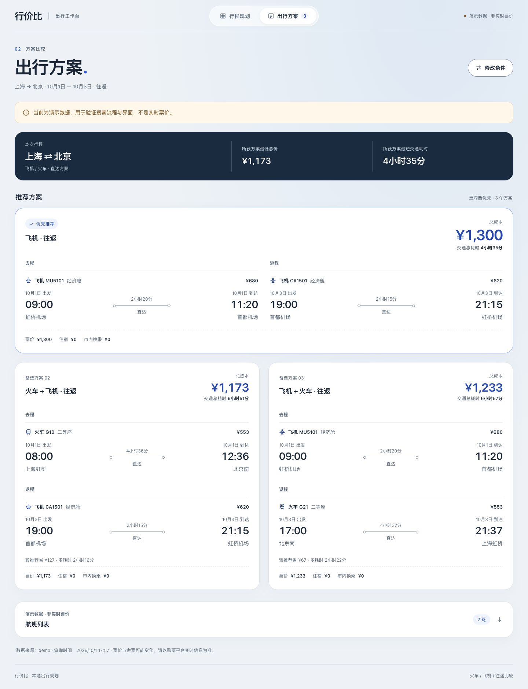

# 行价比 · Xingjiabi

面向大学生的中文出行规划网站：比较中国大陆火车与航班的单程、往返方案，在预算和时间之间做选择。

A local Chinese-language trip planner for students: compare one-way and round-trip train and flight options within mainland China, balancing cost and travel time.



*仓库已有的演示截图，使用固定数据，不代表实时票价。 / Existing demo screenshot using fixed data, not live fares.*

## ✨ 功能 / Features

- **往返联合比较**：把去程与返程组合成完整方案，展示总价、交通耗时和各段时间线。 / **Round-trip comparison**: combine outbound and return trips, showing total cost, travel duration and leg timelines.
- **偏好与预算**：提供省钱、均衡、最快三种排序，并按完整方案总成本筛选预算。 / **Preferences and budget**: rank options by cost, balance or speed, with budget filtering on the whole trip.
- **出行约束**：选择火车或飞机、限定出发时间窗口，提示晚于返校门禁的风险，并可计入跨夜行程住宿成本。 / **Travel constraints**: choose transport modes and departure windows, flag late returns and optionally include lodging costs for overnight travel.
- **MCP 票源接入**：通过统一 Provider 接入 12306 火车票与携程国内航班；部分来源失败时保留可用结果并显示来源错误。 / **MCP data sources**: query 12306 trains and Ctrip domestic flights through a shared Provider interface; preserve available results and report source errors when one source fails.
- **查询反馈**：显示数据模式、来源和查询时间，支持取消当前查询；固定 demo 可离线体验。 / **Query feedback**: display data mode, sources and query time, support cancellation and offer an offline demo.

## 🛠 技术栈 / Stack

- **Python ≥ 3.11**：规划器与标准库 HTTP 服务，根项目无必需第三方依赖。 / Planner and standard-library HTTP server; no required third-party packages for the core demo.
- **HTML · CSS · JavaScript**：原生前端，由同一个 Python 服务提供页面和 JSON 接口。 / Plain frontend, with pages and JSON endpoints served by the same Python process.
- **MCP / stdio**：Node.js · TypeScript 的 12306 服务，Python · FastMCP 的航班服务；Safari 或 DrissionPage / Chromium 用于航班页面读取。 / A Node.js / TypeScript train service and Python / FastMCP flight service; Safari or DrissionPage / Chromium reads flight pages.
- **unittest · Node test runner**：仓库提供 Python 回归测试与前端合约测试。 / The repository includes Python regression tests and frontend contract tests.

## 🚀 快速开始 / Quick start

### 离线演示 / Offline demo

安装 Python 3.11 或更新版本，然后运行： / With Python 3.11 or newer installed:

```bash
git clone https://github.com/Chrischou920-spec/xingjiabi.git
cd xingjiabi
STUDENT_TRIP_DATA_MODE=demo python3 -m student_trip.server
```

打开 [http://127.0.0.1:8765](http://127.0.0.1:8765)。demo 不需要安装票务依赖、登录或访问网络；端口被占用时可加 `STUDENT_TRIP_PORT=8766`。

Open [http://127.0.0.1:8765](http://127.0.0.1:8765). The demo needs no ticket-service dependencies, login or network access. Set `STUDENT_TRIP_PORT=8766` to use another port.

demo 会自动填入固定去返程日期；按下表确认路线、时间窗口和交通方式： / The demo fills in fixed outbound and return dates automatically; confirm the route, time windows and transport modes below:

| 条件 / Field | 值 / Value |
| --- | --- |
| 路线 / Route | 上海 → 北京 / Shanghai → Beijing |
| 去程 / Outbound | 2026-10-01 · 06:00–12:00 |
| 返程 / Return | 2026-10-03 · 16:00–22:30 |
| 交通方式 / Modes | 火车与飞机 / Train and flight |

也可直接查看 demo 的命令行输出： / You can also inspect the demo from the command line:

```bash
python3 -m student_trip.cli --budget 1300 --preference cheapest
```

### 真实票务 / Live data

以下是 macOS / Linux 的本地命令。12306 依赖 Node.js / npm；当前锁文件中的依赖要求 Node.js ≥ 22.7.5。安装后可单独使用真实火车模式：

These local commands target macOS / Linux. The 12306 service requires Node.js / npm; a dependency in the current lockfile requires Node.js ≥ 22.7.5. For live trains only:

```bash
npm ci --prefix services/12306-mcp
npm run build --prefix services/12306-mcp
STUDENT_TRIP_DATA_MODE=live_train python3 -m student_trip.server
```

同时查询火车与航班，先安装航班服务依赖，再启动： / To query both trains and flights, install the flight-service dependencies first:

```bash
python3 -m venv .venv
.venv/bin/python -m pip install -r services/FlightTicketMCP/requirements.txt
bash scripts/start-local.sh
```

`start-local.sh` 默认 `live_all`，要求已有 `.venv` 和 12306 构建产物；macOS 默认 Safari。请先在 Safari 登录携程，并按需完成系统自动化授权、登录和验证码。保留程序创建的 `#xingjiabi-live` 查询标签页；Safari 只读取已加载的直达航班，不能保证覆盖全部分页。

`start-local.sh` defaults to `live_all` and requires `.venv` plus the built 12306 service. On macOS it defaults to Safari. Log in to Ctrip in Safari and complete any macOS automation permission, login or verification prompts. Keep the `#xingjiabi-live` query tab open; Safari reads loaded direct flights and does not guarantee full pagination coverage.

其他平台或需要独立浏览器时，设置 `FLIGHT_BROWSER_ENGINE=chromium`，并安装 Chrome / Chromium；可用 `FLIGHT_BROWSER_PATH` 指定浏览器可执行文件。运行时使用 DrissionPage，Playwright 不是必需依赖；若需要用 Playwright 下载 Chromium，可额外执行：

For other platforms or a separate browser, set `FLIGHT_BROWSER_ENGINE=chromium` and install Chrome / Chromium; use `FLIGHT_BROWSER_PATH` to specify its executable. Flight queries use DrissionPage, so Playwright is optional. To download Chromium with Playwright:

```bash
.venv/bin/python -m pip install playwright
.venv/bin/python -m playwright install chromium
FLIGHT_BROWSER_ENGINE=chromium bash scripts/start-local.sh
```

若下载的 Chromium 没有被发现，先将 `FLIGHT_BROWSER_PATH` 设为该浏览器的实际可执行文件路径；当前 Provider 的 Playwright 缓存查找仅覆盖 macOS ARM 路径。 / If the downloaded Chromium is not found, set `FLIGHT_BROWSER_PATH` to its actual executable; the Provider's Playwright-cache lookup currently covers macOS ARM paths only.

真实查询受源站、网络、浏览器页面及人工验证影响，请使用当次有效的出行日期；不会自动混入 demo 票。航班依赖以 `requirements.txt` 为准，航班子项目 `pyproject.toml` 未声明 DrissionPage。

Live queries depend on the upstream sites, network, browser pages and manual verification. Use valid travel dates; demo tickets are never silently substituted. Install flight dependencies from `requirements.txt`; the flight subproject's `pyproject.toml` does not declare DrissionPage.

## 数据边界 / Scope

- 本地运行、中国大陆城市、直达路线；不提供订票或支付。 / Local use, mainland Chinese cities and direct routes; no booking or payment.
- 内核有一次中转和空铁组合计算能力，但网站未配置中转枢纽，当前 UI 不提供中转搜索。 / The core can calculate one-transfer and mixed-mode routes, but the website has no configured transfer hubs or transfer-search UI.
- 时间窗口筛选出发时间；交通耗时不包含目的地停留时间；住宿成本仅用于单段行程跨日，不包含目的地整个停留期间的酒店预算。 / Time windows filter departures; travel duration excludes time spent at the destination; lodging costs cover overnight travel legs, not the whole destination stay.
- 固定 demo 用于复现界面和算法，不代表当天可购买的票。历史真实查询记录也不保证今天的来源可用。 / The fixed demo reproduces the UI and algorithm, not tickets available today. Historical live-query records do not guarantee current availability.

## 代码与文档 / Code and docs

[规划算法 / Planner](student_trip/planner.py) · [HTTP 与来源错误处理 / HTTP and source errors](student_trip/server.py) · [票务服务 / Ticket services](services/README.md) · [航班调试记录 / Flight debugging notes](docs/FLIGHT_DEBUG.md) · [UI 规范 / UI guidelines](design-system/xingjiabi/MASTER.md)

运行已有回归与前端合约测试： / Run the existing regression and frontend contract tests:

```bash
python3 -m unittest discover -s tests -v
node --test tests/test_web_ui.cjs
```

测试命令用于本地检查，不代表真实票务来源已验收。 / These checks do not validate the current availability of live ticket sources.
